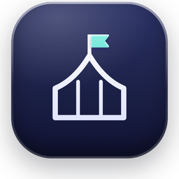
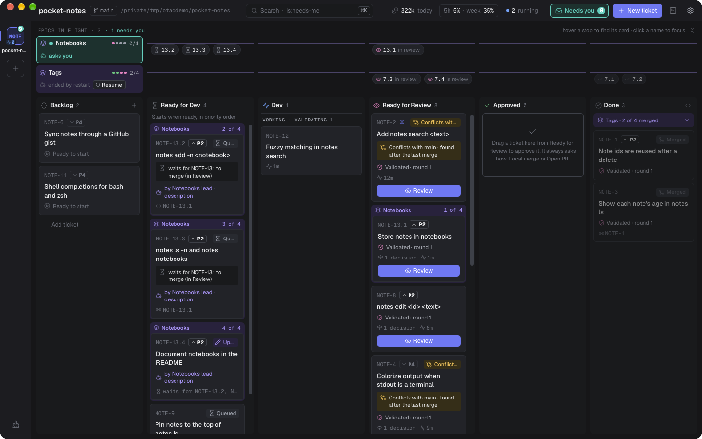
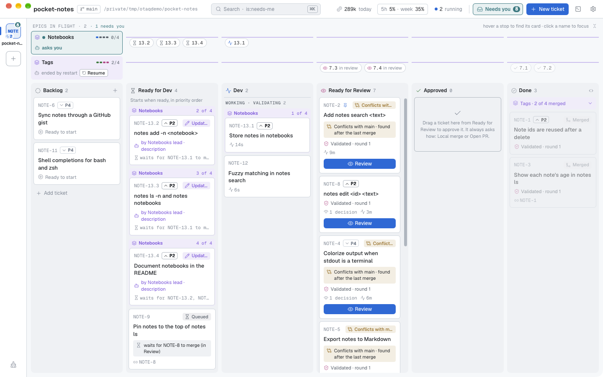
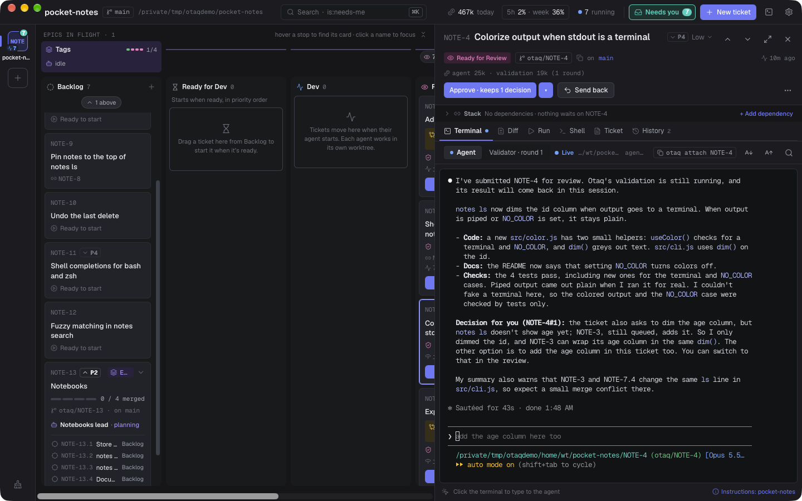
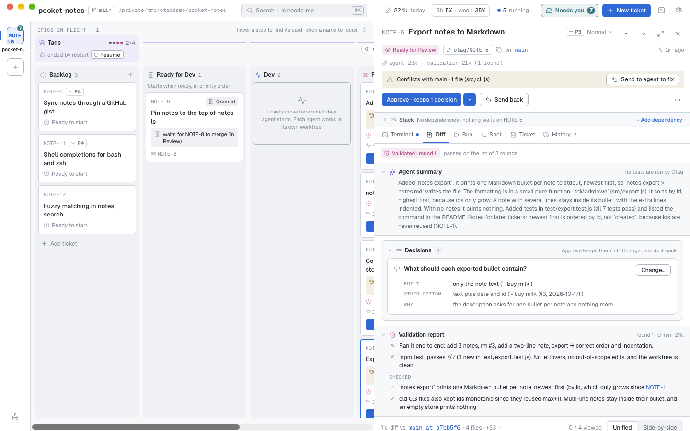
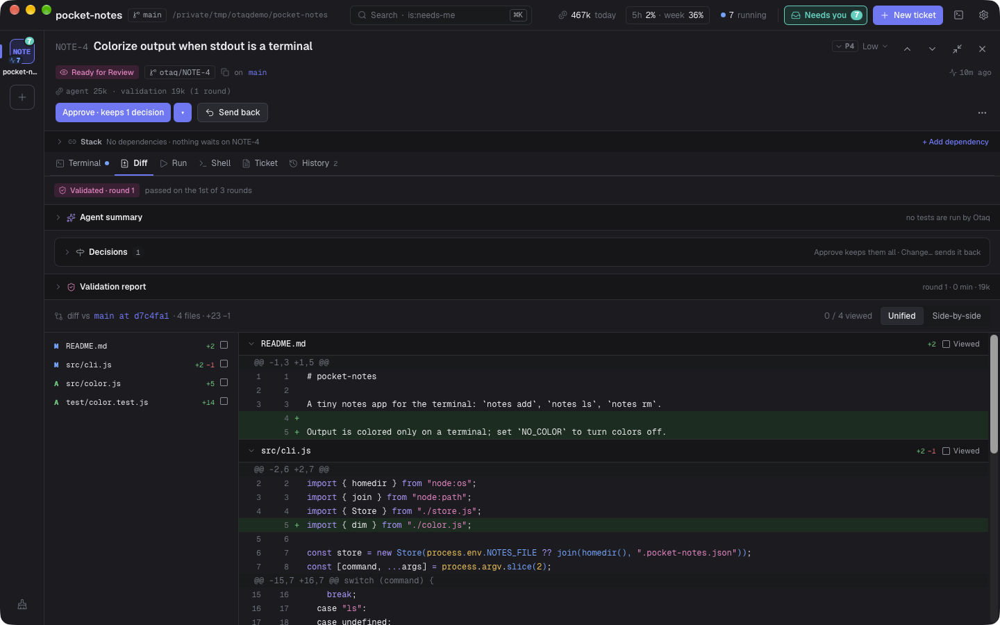
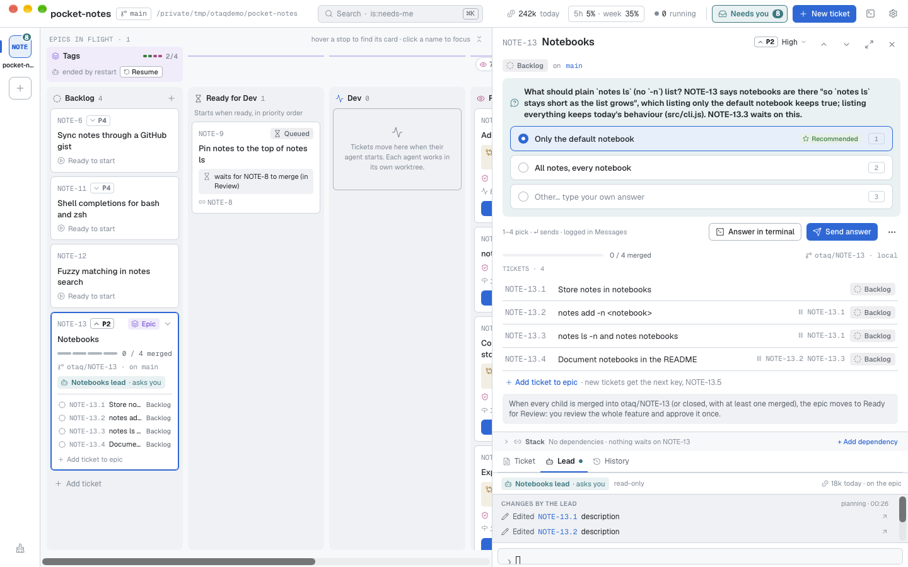

<p align="center">
  
</p>

<h1 align="center">Otaq</h1>

<p align="center">
  <b>A kanban board that runs Claude Code agents for you.</b><br>
  Drag a ticket to <b>Dev</b>. An agent picks it up in its own git worktree, a second agent checks the work,
  and the ticket lands in <b>Ready for Review</b> with a diff waiting for you.
</p>

<p align="center">
  
</p>

---

Otaq is a desktop app for one developer supervising many coding agents at once. You write tickets the way you
would for a teammate. Otaq starts a real, interactive `claude` session for each ticket, keeps them out of each
other's way, tells you when one needs you, and gives you a normal code review at the end. Nothing is merged or
pushed until you say so.

It is built in Rust (the engine and a background service) with a Tauri + React window, runs on macOS, Windows and
Linux, and is MIT licensed.

> **Status: early (v0.1).** Otaq is used daily by its author and is now public. There are no prebuilt releases
> yet; build it from source (below). Expect rough edges, and please open issues.

## Contents

- [Why Otaq](#why-otaq)
- [How it works](#how-it-works)
- [A tour of the app](#a-tour-of-the-app)
- [Getting started](#getting-started)
- [The `otaq` command](#the-otaq-command)
- [Architecture](#architecture)
- [Development](#development)
- [License](#license)

## Why Otaq

Running one Claude Code session is easy. Running eight at once is not: they edit the same checkout, you lose track of
which one is waiting on a question, and reviewing the result means digging through branches. Otaq turns that into a
board.

- **One ticket, one agent, one worktree.** Every ticket gets its own git worktree and branch, so parallel agents never
  step on each other or on your own checkout.
- **Dependencies, so work happens in order.** Ticket B can wait for ticket A. B starts only once A is merged, so it
  always builds on finished work.
- **The real Claude Code terminal.** Agents run the actual `claude` CLI, not an imitation. You can watch any agent and
  type into its session at any moment.
- **You only look when it matters.** Cards that need you (a question, a permission prompt, an agent that stopped)
  turn turquoise and jump to the top, and land in one inbox across all projects.
- **A second pair of eyes.** When an agent says it's done, a separate read-only *validator* agent checks the change
  against the ticket. Failures go straight back to the agent; only passing work reaches you.
- **Review like a pull request.** Diff against the ticket's starting point, line comments, Send back, then Approve with a
  local squash merge or a GitHub / Azure DevOps pull request.
- **Agents keep running when the window is closed.** A background service owns every session; reopen the app and
  everything is where you left it.
- **Your setup, untouched.** Otaq uses your own Claude Code settings and permission mode, your `git`, `gh` and `az`
  logins, and never adds files to your repository.

## How it works

```
Backlog ──► Ready for Dev ──► Dev ──────────────► Ready for Review ──► Approved ──► Done
            (waits for its     agent works,        you read the diff,   local merge
             dependencies      validator checks    comment, send back   or open a PR
             and a free slot)  the result          or approve
```

1. **Write tickets.** A title and a description in a rich Markdown editor. Acceptance criteria are just text in the
   description. Give a ticket a priority (Urgent, High, Normal, Low) and the tickets it depends on.
2. **Drag a ticket to Dev** (or Ready for Dev). If its dependencies are merged, Otaq creates a worktree from your base
   branch, runs your setup command (for example `pnpm install`), and starts `claude` with the ticket.
3. **The agent works.** It reads its ticket through the `otaq` command, plans, implements and commits. If it hits a
   question it can't answer from the code or docs, it asks you (the card turns turquoise, with answer options). Smaller
   product choices it makes on its own and records on the ticket, so you can see them in review.
4. **The validator checks.** When the agent submits, a fresh read-only agent compares the change with the ticket and
   the checks you asked for. If something is missing, the findings go back to the agent (up to 3 rounds by default).
5. **You review.** The ticket arrives in Ready for Review with its diff, the agent's summary, the validator's report and
   every decision the agent recorded. Comment on lines and **Send back**, or **Approve**.
6. **Merge.** *Local merge* squashes the branch into your base branch (rebasing first if the base moved). *Open PR*
   pushes and opens a pull request, with a dialog where you edit the branch name, title and description first.
   When it's merged, tickets that were waiting on it start on their own.

### Epics: one feature, many tickets

Bigger features become an **epic** with child tickets (`NOTE-7.1`, `NOTE-7.2`, …). Children branch from the epic's own
integration branch and merge back into it, so the feature reaches your base branch, or a pull request, as **one**
change when every child is done. On the board an active epic is a **track** above the columns, with one stop per
child, so you see the whole feature at a glance.

An epic can have a **lead**: a read-only agent that plans the children with you, answers their questions first (and
passes on the ones it can't, with a recommended answer), shares what each merged child learned with the ones still to
come, and flags children that touch the same files. It never edits code or merges anything.

### Project agents and terminals

From **Terminals & agents** you can open a plain terminal in the project, or a **Project agent**: a Claude Code session
that investigates the codebase and writes Backlog tickets for you, including importing them from your team's tracker
with your own skills. It reads code but never edits it.

## A tour of the app

> The screenshots show a small demo project, `pocket-notes` (a notes app for the terminal), with real Claude Code
> agents working on it.

### The board



Six columns: Backlog, Ready for Dev, Dev, Ready for Review, Approved and Done. Above them, **Epics in flight** shows one
track per active epic, with a stop for each child under the column it's in. Cards show status, priority, what they
wait for (`waits for NOTE-8 to merge`), validation rounds, recorded decisions and conflicts with the base branch.
Hover a card to highlight its dependency chain. Turquoise means "needs you", magenta means "in review".

### A live agent



Click a card to open its side panel, with the tabs **Terminal · Diff · Run · Shell · Ticket · History**. The terminal is
the agent's real Claude Code session, and you can type into it at any time. Otaq never mixes its own messages into text
you've started typing. Here the agent has finished `NOTE-5` and explains a product choice it made on its own. From any
terminal, `otaq attach NOTE-5` opens the same session.

### Review



A ticket in Ready for Review shows what the agent says it did, every decision it recorded (what it built, the other
option, and why), and the validator's report. **Approve** keeps the decisions; **Change…** on a decision, or **Send
back** with comments, returns the ticket to the same agent.



Below that is the diff against the commit where the ticket started, unified or side by side, with a file list, "viewed"
checkboxes and line comments. Approve offers **Local merge** or **Open PR**.

### Epics and the epic lead



The epic panel lists the epic's tickets and their dependencies, and holds the lead's terminal. Here the lead of the
*Notebooks* epic is planning: it has already edited two child tickets' descriptions, and now asks one question it
can't settle from the code, with a recommended answer. You answer with a click (or in its terminal), and the children
it refined start when the epic is dragged to Ready for Dev.

### Run and Shell

Every ticket gets its own ports, exposed as `$PORT`, so several agents can run dev servers at once. **Run** starts the
project's run command for that ticket when you click it, with a log and an optional Open URL. **Shell** is a plain
terminal in the ticket's worktree.

### Themes

15 bundled themes, picked on first run and in Settings: Otaq Dark (the screenshot at the top) and Otaq Light,
Catppuccin (Latte, Frappé, Macchiato, Mocha), Tokyo Night, Dracula, Nord, Gruvbox Dark, Rosé Pine and Rosé Pine Dawn,
One Dark, Daylight (the board above) and Solarized Light.

## Getting started

### What you need

| | |
|---|---|
| **Claude Code** | the `claude` CLI, installed and logged in |
| **git** | any recent version |
| **OS** | macOS (most tested), Windows 10/11, or Linux |
| **To build** | Rust 1.99+ (edition 2024) and Node 24 |
| **Optional** | `gh` (GitHub) or `az` (Azure DevOps) for pull requests |

### Build and run from source

```sh
git clone https://github.com/otaq-dev/otaq.git
cd otaq

# The desktop app (the web page is built into the binary)
cd crates/otaq-desktop
npm ci
npm run tauri build      # → target/release/otaq-app
cd ../..

# The otaq command: opens the app, runs the background service, and is what agents call
cargo build --release -p otaq-cli   # → target/release/otaq
```

Put `target/release` on your `PATH` and run `otaq`. With no arguments it opens the app, starting the background
service if needed.

Prebuilt downloads for macOS, Windows and Linux (with a one-line install script) are planned. The builds won't be code
signed, so the first open will show the usual "unidentified developer" warning (on macOS: right-click → Open, or
`xattr -dr com.apple.quarantine Otaq.app`; on Windows: More info → Run anyway).

### Your first project

1. Open Otaq and **add a project**: any folder that is a git repository. Otaq suggests a short key (`SHOP`) used in
   ticket names (`SHOP-12`) and picks your base branch from the remote.
2. Optional, in the project's settings: a **setup** command run in every new worktree (`pnpm install`), a **run**
   command for the Run tab (`pnpm dev --port $PORT`), environment variables, and Agent instructions (for example
   "run `cargo test` before you submit").
3. **Create a ticket**, drag it to **Dev**, and watch the agent start.

Agents use your own Claude Code permission mode. In a mode that asks before edits, they will stop on permission prompts
and show up as "Needs you"; auto-accept modes let them run unattended. Otaq pre-approves only its own `otaq` commands.

### Where things live

- **Data:** `~/.otaq/` (a SQLite database, logs, the service socket). Set `OTAQ_HOME` to use another folder.
- **Worktrees:** `~/.otaq/wt/<repo>/<TICKET>`, outside your repository. Branches are named `otaq/SHOP-12` while
  work is in progress.
- **Warm builds:** a new worktree starts from a copy-on-write clone of the last finished ticket's build output (APFS,
  btrfs, XFS, ReFS), so its first build only redoes what changed.

### Anonymous usage data

When first run ends, Otaq asks once: **"Help improve Otaq"**. Nothing is sent unless you press *Send anonymous data*;
*No thanks* (or Esc) means nothing is ever sent, and Otaq works the same either way. Change it anytime in
Settings → Data → *Send anonymous usage data*.

If you agree, Otaq sends to [Aptabase](https://aptabase.com) (EU region) which features are used and how often, with
the Otaq version and your OS. It never sends ticket text, code, diffs, prompts, project, file or branch names, paths,
or any ID that follows you across launches: each launch gets a new random session, and nothing is stored on disk. The
full list of what counts as a feature is in [`crates/otaq-desktop/src/usage.rs`](crates/otaq-desktop/src/usage.rs).
Builds from source send nothing at all: the Aptabase App Key is only built into release builds
(`OTAQ_APTABASE_APP_KEY`).

## The `otaq` command

`otaq` is both your tool and the agents' tool. Agents use it (taught by the bundled Claude Code plugin) to read their
ticket, ask questions and submit; you can use the same commands from any terminal.

```sh
otaq                         # open the app
otaq list -P SHOP            # the project's tickets
otaq create "Fix login" -p 2 --deps SHOP-12
otaq create -f plan.md       # many tickets from one Markdown file
otaq show SHOP-18
otaq dep tree SHOP-18
otaq attach SHOP-18          # this ticket's live agent session, in your terminal
otaq daemon status           # the background service
```

Every command takes `--json`. Run `otaq --help` for the full list.

The agent's workflow lives in a Claude Code plugin in [`plugin/`](plugin): `work-ticket` (the main loop), `validate`,
`commit`, `push`, `open-pr`, `address-review`, `restack`, `epic-lead` and `project-agent`. You can replace the commit,
push, open-PR and validate skills with your own, globally or per project. The plugin only acts when `OTAQ_TICKET` is
set, so your ordinary `claude` sessions are unaffected.

## Architecture

```
Otaq app (Tauri + React) ◄── local socket ──► otaq daemon (Rust core) ◄── PTY ──► claude, one per ticket
                                                    │                              (cwd = the ticket's worktree)
                                                    ├── SQLite (~/.otaq/otaq.db)
                                                    └── git worktrees, ports, Run and Shell processes
```

| Crate | What it is |
|---|---|
| [`otaq-core`](crates/otaq-core) | the engine: tickets, dependencies, scheduler, git and worktrees, sessions, validation, the socket server; runs as `otaq daemon` |
| [`otaq-view`](crates/otaq-view) | screen logic as plain, tested Rust view models, no UI framework |
| [`otaq-desktop`](crates/otaq-desktop) | the Tauri 2 app with a React + TypeScript page, xterm.js terminals and the Tiptap Markdown editor |
| [`otaq-cli`](crates/otaq-cli) | the `otaq` binary: opens the app, `daemon`, `attach`, hooks and the agent commands |
| [`plugin/`](plugin) | the Claude Code plugin: skills and hooks that define how agents behave |

The app, the CLI and the agents all talk to the same background service over a user-only local socket, using
newline-delimited JSON.

## Development

```sh
cd crates/otaq-desktop
npm ci
npm run tauri dev        # the app with live reload
```

Use a throwaway data folder while developing: `OTAQ_HOME=/tmp/otaq-dev npm run tauri dev`.

Every change must pass `scripts/check.sh` (macOS and Linux) or `scripts/check.ps1` (Windows): typecheck, lint, format
and tests for the page, then `cargo fmt`, `clippy -D warnings` and `cargo test --workspace`. See
[`scripts/README.md`](scripts/README.md) and [`crates/otaq-desktop/README.md`](crates/otaq-desktop/README.md) for how
the frontend is put together.

## License

MIT, see [`LICENSE`](LICENSE). Third-party notices are in [`THIRD-PARTY-LICENSES.md`](THIRD-PARTY-LICENSES.md) and in
the app under Settings → About.
